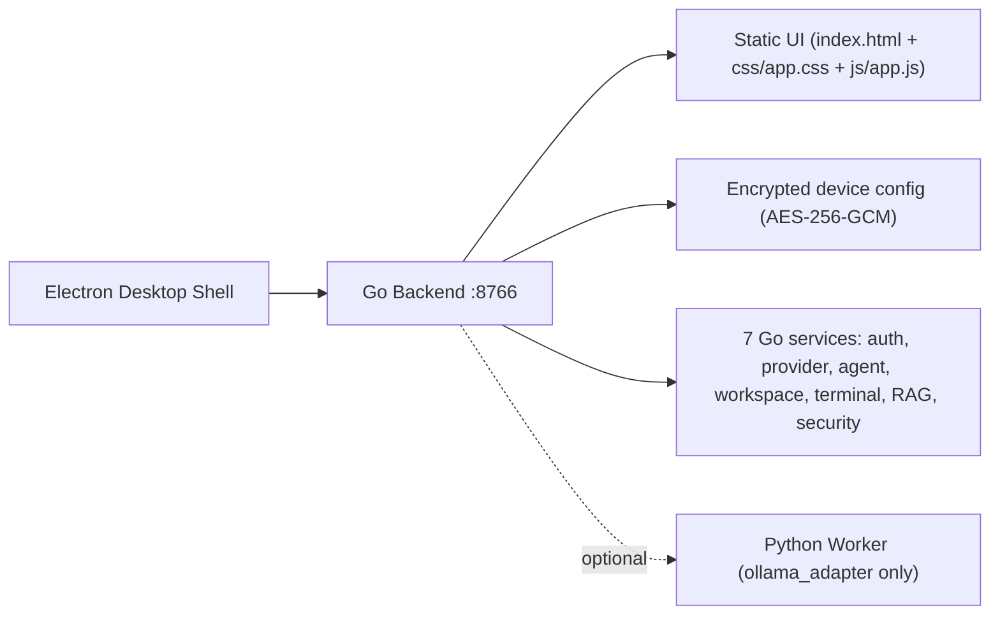

# KaguyaIDE 3.1.0 Desktop

Windows desktop IDE for AI-assisted development.

## Architecture



## Directory Structure

```text
KaguyaIDE-3.1.0-win64-Desktop/
├── Kaguya IDE.exe              # Electron app
├── main.js                     # Legacy entry (uses app.asar.src/electron/main.js)
├── resources/
│   ├── app.asar.src/           # Electron source
│   │   └── electron/
│   │       ├── main.js         # Main process (1,831 lines)
│   │       └── preload.js      # Preload script
│   ├── go-backend/             # Go backend (primary HTTP server)
│   │   ├── main.go             # Entry point
│   │   ├── server.go           # HTTP router + glue
│   │   ├── *_service.go        # 7 domain services
│   │   ├── *_generated.go      # Migration contracts (slimmed)
│   │   ├── static/             # Frontend assets
│   │   │   ├── index.html      # HTML shell (3,361 lines)
│   │   │   ├── css/app.css     # Styles (2,807 lines)
│   │   │   └── js/app.js       # Frontend logic (9,813 lines)
│   │   └── build/              # Compiled binary output
│   └── python-app/             # Python compatibility layer
│       ├── start_server.py     # Launcher (spawns Go backend)
│       ├── ollama_adapter.py   # Model inference adapter
│       ├── kaguya_core/        # Shared infrastructure
│       ├── scripts/            # Generation scripts
│       └── tests/              # Python tests
├── CONTEXT.md                  # Domain glossary
├── docs/
│   └── adr/                    # Architecture decision records
├── AUDIT_NOTES.md
├── IPC_CONTRACT.md
└── README.md
```

## Go Backend Services

| File | Responsibility |
|------|---------------|
| `main.go` | Process entry, CLI args, HTTP listen |
| `server.go` | HTTP router and glue layer |
| `auth_account_service.go` | Local accounts, sessions, tokens |
| `provider_chat_service.go` | OpenAI-compatible provider client |
| `agent_runtime_service.go` | Agent runs, abort, SSE frames |
| `workspace_project_service.go` | Workspace authorization, file ops |
| `terminal_permission_service.go` | Command risk, permission decisions |
| `knowledge_rag_service.go` | KB/RAG document library |
| `security_privacy_service.go` | Loopback policy, privacy settings |

## Build

```bash
cd resources/go-backend
go build -o build/kaguya-go-backend.exe .
go test ./... -cover
```

## Testing

```bash
cd resources/go-backend && go test ./... -v
cd resources/python-app && python -m pytest tests/ -v
```
